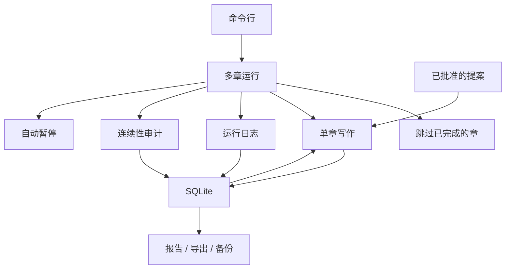
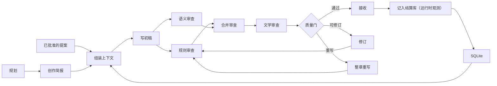

<div align="center">
  

  <h1>Songyan（松烟）</h1>

  <p><strong>人主导的连载写作助手</strong></p>
  <p>Canon 记下你确认过的事实。生成是可选的草稿。当前 tip 是 <strong>v0.5 技术预览 / 引擎</strong>。</p>
  <p><em>A local-first writing assistant: confirmed Canon, optional generation. This tip is the v0.5 engine.</em></p>

  <p>
    
    <a href="https://www.python.org/">= 3.11" /></a>
    <a href="LICENSE"></a>
    <a href="https://github.com/Bingtuu/Songyan/actions/workflows/ci.yml"></a>
    
    
  </p>
</div>

---

## 目标

Songyan 是人主导的连载写作助手。已确认的 Canon 是事实；需要探索写法时，再用本机引擎出草稿。终稿由人定。

当前能跑的包是 **v0.5**（`0.5.0`）。多个 Agent 在 LangGraph 上分工，长期记录在 SQLite。产品方向在 [V1.0 PRD](docs/prd-v1.md)（已接受）。**M0–M4 代码验收全量 PASS（M4 @ `e5a33bd`）；tech-m4 §9 与 S5 产品向、post-M4 路线方向 A/C/B 均已闭环**——细节与命令全表见 [STATUS](docs/STATUS.md) / [AGENTS.md](AGENTS.md)。文中标了 `[proposed]`、且尚未落地的命令不要当成已支持。

- **Canon 由你确认。** 人物、物件、时间和已经发生的事，以你批准的事实为准。
- **生成可选。** 模型按已批准的提案（计划卡）起草，审查标出写偏的地方。
- **终稿归人。** 质量门通过不算书写得好。

草稿、修订和已接收的版本都留着，不覆盖旧稿。这是命令行工具，适合能自己配置模型 API key 的人。

## 结构

### 系统

下图是 **v0.5 引擎**。命令行可以一次跑很多章，写完的章节、日志和导出回到本机的 SQLite。这是管线能力。作者路径（`today` / `canon` / `check` / `variant` / `chapter` / `review` / `storyline` / `signals`）已全部落地，细节见 [STATUS](docs/STATUS.md)，术语口径见 [术语表](docs/glossary.md)。



### 一章怎么走（v0.5 引擎）

已批准的提案只进入当前这一章。还没批准的、别的章、别的项目不会混进来。

从正文抽出的细节写进结算库。结算库是**运行时观测**，已批准的提案保持原样。作者路径（提案 → 人确认入典）与章内抽卡（`variant`）均已落地；M4 起的续写短环（`chapter continue`）、共审（`review`）、故事线编辑（`storyline`）与信号（`signals`）也已可用。未落地的仍以 PRD `[proposed]` 为准。



| 路径 | 作用 |
|------|------|
| `src/songyan/workflows/` | 章节编排 |
| `src/songyan/agents/` | 规划、写作、审查、修订、结算 |
| `src/songyan/plan_facts/` | 已批准的提案（计划卡） |
| `src/songyan/db/` | SQLite 的表和读写 |
| `src/songyan/cli/` | `songyan` 命令 |
| `src/songyan/genres/`、`src/songyan/project_templates/` | 体裁配置和建项模板 |
| `src/songyan/prompts/` | 提示词卡片 |
| `docs/` | 使用说明和发布文档 |

设计取舍见 [ADR-0001](docs/adr/0001-plan-first-facts.md)。下一阶段是人主导的写作助手，规划在 [V1.0 PRD](docs/prd-v1.md)；包版本仍是 v0.5。Plan-first 阶段 A–C 已关闭。

## 使用方式

需要 Python 3.11+、一个兼容 OpenAI 接口的模型服务（示例是 DeepSeek），以及一块可写的本地目录。

```powershell
python -m pip install -e ".[dev]"
Copy-Item .env.example .env
```

bash 里把复制换成 `cp .env.example .env`。在 `.env` 里填上 API key、接口地址、模型名和数据库路径。按角色换模型，以及为什么写作角色不要用带思考链的模型，见 [Quickstart](docs/quickstart.md)。

自检并建项：

```powershell
songyan doctor --init-db
songyan create-project --template scifi
```

`create-project` 会打印 `project_id`。模板还有 `xuanhuan`、`wuxia`、`urban` 等。

下面是**管线冒烟示例**，用来看引擎能不能跑完前三章。它不是作者主路径。

```powershell
songyan run --project-id <project_id> --chapters 1-3 --auto-confirm
songyan report --run-id <run_id>
songyan export --project-id <project_id> --chapters 1-3 --format md --output exports/
```

`run` 会打印 `run_id`，这是**引擎冒烟路径**。作者路径命令均已落地：工作台（`today`、`canon show|pending`、`canon confirm [entity|attribute|batch|promise]`、`check`、`storyline show|edit|remove`、`project list`、`signals`、`status`）、抽卡（`variant list|generate|diff|pick|abandon`）、W2 短环（`chapter continue [--chapter N]|accept|status`、`review [--deep]`）。备份与排错见 [Quickstart](docs/quickstart.md)；导入已有小说见 `songyan import --help`。

报告里的费用按这个口径估算：输入 **¥2/M**，输出 **¥8/M**，单章停线 **¥7.66**。这是估算，不是供应商账单。

## 进展

**v0.5**（包版本 `0.5.0`）。「V1.0」是产品代际名，不是这个包版本。**M0–M4 代码验收全量 PASS；tech-m4 §9 与 S5 产品向、post-M4 方向 A/C/B 均已闭环**（详见 [STATUS](docs/STATUS.md)）。Ch1–10 在 `47954cb` 上只是管线证据：过程门通过，人工阅读未通过，不能当成可读长篇。

把现成书稿导入后再接着写，自动化测试已经有了；用真实书稿续写，还没有验收。

证据和发布门槛见 [STATUS](docs/STATUS.md) 与 [Release Checklist](docs/release-checklist.md)。更早的长窗口公开数字在 [baseline 摘要](docs/baseline-results.md)。

## 文档

| 文档 | 何时去看 |
|------|----------|
| [V1.0 PRD](docs/prd-v1.md) | 产品规划（已接受）。当前 tip 仍是 v0.5；未落地的 `[proposed]` 命令不要当成已支持 |
| [M0 技术方案](docs/tech-m0.md) | 只读工作台。已接受；步 1–4 与 §6–7 代码验收 PASS |
| [M1 技术方案](docs/tech-m1.md) | 人确认入典 + 规则 `check`。已接受；步 1–5 与 §6–7 PASS |
| [M2 技术方案](docs/tech-m2.md) | 硬事实标脏 + 承诺债务 + 抽取提案。已接受；步 1–6 与 §6–7 PASS |
| [M3 技术方案](docs/tech-m3.md) | 章内 Variant / 抽卡。已接受；步 1–6 已落地；§6–7 代码验收 PASS @ `594144b` |
| [AGENTS.md](AGENTS.md) | 贡献者和代理先读：现在是什么、不要加载哪些历史文档 |
| [Quickstart](docs/quickstart.md) | 安装、配置、短窗口、导出 |
| [STATUS](docs/STATUS.md) | 现在能用什么、限制、当前接手节点 |
| [术语表](docs/glossary.md) | 用户面统一术语口径（task 264） |
| [Release Checklist](docs/release-checklist.md) | 发布前要核对的项 |
| [baseline 摘要](docs/baseline-results.md) | 更早长窗口的公开数字 |
| [Troubleshooting](docs/troubleshooting.md) | 失败了怎么恢复 |
| [Changelog](CHANGELOG.md) | 版本记录 |
| [文档索引](docs/INDEX.md) | 当前文档地图；历史材料在归档里 |

## 参与贡献

先读 [AGENTS.md](AGENTS.md)，再看 [CONTRIBUTING](CONTRIBUTING.md)。当前贡献主路径是已接受的 V1.0 PRD 和 `tasks/`，不是 plan-first 每日切片。提问题前先看 [最小复现指南](docs/minimal-repro.md)。不要提交 `.env`、API key、书稿、本地数据库或未脱敏日志；需要附诊断时用 `songyan bundle-run`。

## 许可证

Songyan 使用 [AGPL-3.0](LICENSE)。
