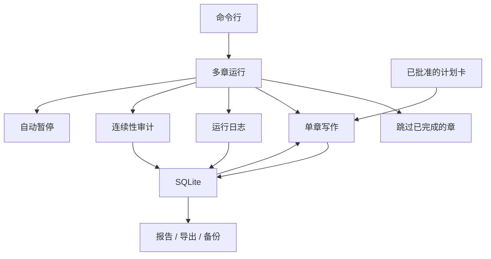
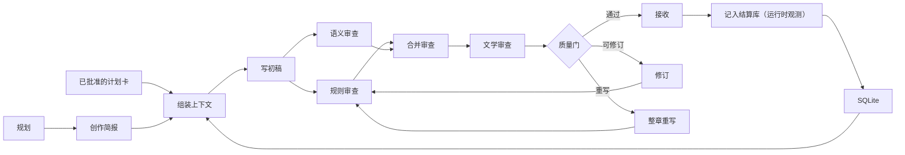

<div align="center">
  

  <h1>Songyan（松烟）</h1>

  <p><strong>人主导的连载写作助手</strong></p>
  <p>Canon 记下你确认过的事实。生成是可选的草稿。当前 tip 是 <strong>v0.5 技术预览 / 引擎</strong>。</p>
  <p><em>A local-first writing assistant: confirmed Canon, optional generation. This tip is the v0.5 engine.</em></p>

  <p>
    
    <a href="https://www.python.org/">= 3.11" /></a>
    <a href="LICENSE"></a>
    <a href="https://github.com/Bingtuu/Songyan/actions/workflows/ci.yml"></a>
    
    
  </p>
</div>

---

## 目标

Songyan 是人主导的连载写作助手。已确认的 Canon 是事实；需要探索写法时，再用本机引擎出草稿。终稿由人定。

当前能跑的包是 **v0.5 技术预览 / 引擎**（`0.5.0`）。多个 Agent 在 LangGraph 上分工，长期记录在 SQLite。下一阶段的产品方向在 [V1.0 PRD](docs/prd-v1-writing-assist.md)。文中标了 `[proposed]` 的命令还没有实现。

- **Canon 由你确认。** 人物、物件、时间和已经发生的事，以你批准的事实为准。
- **生成可选。** 模型可以按已批准的计划卡起草，审查标出写偏的地方。
- **终稿归人。** 质量门通过不算书写得好。

草稿、修订和已接收的版本都留着，不覆盖旧稿。这是命令行工具，适合能自己配置模型 API key 的人。

## 结构

### 系统

下图是 **v0.5 引擎**。命令行可以一次跑很多章，写完的章节、日志和导出回到本机的 SQLite。这是管线能力。作者每天要走的 `today` / `canon` / `check` 写在 PRD 里，这一版还没有发出。



### 一章怎么走（v0.5 引擎）

计划卡只进入当前这一章。还没批准的卡、别的章、别的项目不会混进来。

从正文抽出的细节写进结算库。结算库是**运行时观测**，已经批准的计划卡保持原样。V1.0 的作者路径是提案，再确认入典。这个改写还没有进代码。



| 路径 | 作用 |
|------|------|
| `src/songyan/workflows/` | 章节编排 |
| `src/songyan/agents/` | 规划、写作、审查、修订、结算 |
| `src/songyan/plan_facts/` | 已批准的计划卡 |
| `src/songyan/db/` | SQLite 的表和读写 |
| `src/songyan/cli/` | `songyan` 命令 |
| `src/songyan/genres/`、`src/songyan/project_templates/` | 体裁配置和建项模板 |
| `src/songyan/prompts/` | 提示词卡片 |
| `docs/` | 使用说明和发布文档 |

设计取舍见 [ADR-0001](docs/adr/0001-plan-first-facts.md)。下一阶段是人主导的写作助手，规划在 [V1.0 PRD](docs/prd-v1-writing-assist.md)；包版本仍是 v0.5。Plan-first 阶段 A–C 已关闭。

## 使用方式

需要 Python 3.11+、一个兼容 OpenAI 接口的模型服务（示例是 DeepSeek），以及一块可写的本地目录。

```powershell
python -m pip install -e ".[dev]"
Copy-Item .env.example .env
```

bash 里把复制换成 `cp .env.example .env`。在 `.env` 里填上 API key、接口地址、模型名和数据库路径。按角色换模型，以及为什么写作角色不要用带思考链的模型，见 [Quickstart](docs/quickstart.md)。

自检并建项：

```powershell
songyan doctor --init-db
songyan create-project --template scifi
```

`create-project` 会打印 `project_id`。模板还有 `xuanhuan`、`wuxia`、`urban` 等。

下面是**管线冒烟示例**，用来看引擎能不能跑完前三章。它不是作者主路径。

```powershell
songyan run --project-id <project_id> --chapters 1-3 --auto-confirm
songyan report --run-id <run_id>
songyan export --project-id <project_id> --chapters 1-3 --format md --output exports/
```

`run` 会打印 `run_id`。助手命令（`today`、`canon`、`check`、抽卡）在 [V1.0 PRD](docs/prd-v1-writing-assist.md)，这一版还没有发出。备份、导入已有小说、质量门和排错都在 [Quickstart](docs/quickstart.md)。

报告里的费用按这个口径估算：输入 **¥2/M**，输出 **¥8/M**，单章停线 **¥7.66**。这是估算，不是供应商账单。

## 进展

**v0.5**（包版本 `0.5.0`）是技术预览。「V1.0」是下一阶段的产品代际名，不是这个包版本。科幻模板的真实模型前三章已经跑通。Ch1–10 在 `47954cb` 上只是管线证据：过程门通过，人工阅读未通过，不能当成可读长篇。详见 [STATUS](docs/STATUS.md)。

把现成书稿导入后再接着写，自动化测试已经有了；用真实书稿续写，还没有验收。

证据和发布门槛见 [STATUS](docs/STATUS.md) 与 [Release Checklist](docs/release-checklist.md)。更早的长窗口公开数字在 [baseline 摘要](docs/baseline-results.md)。

## 文档

| 文档 | 何时去看 |
|------|----------|
| [V1.0 写作助手 PRD](docs/prd-v1-writing-assist.md) | 下一阶段产品规划；当前 tip 仍是 v0.5；文中 proposed 命令还没实现 |
| [AGENTS.md](AGENTS.md) | 贡献者和代理先读：现在是什么、不要加载哪些历史文档 |
| [Quickstart](docs/quickstart.md) | 安装、配置、短窗口、导出 |
| [STATUS](docs/STATUS.md) | 现在能用什么，以及限制 |
| [Release Checklist](docs/release-checklist.md) | 发布前要核对的项 |
| [baseline 摘要](docs/baseline-results.md) | 更早长窗口的公开数字 |
| [Troubleshooting](docs/troubleshooting.md) | 失败了怎么恢复 |
| [Changelog](CHANGELOG.md) | 版本记录 |
| [文档索引](docs/INDEX.md) | 当前文档地图；历史材料在归档里 |

## 参与贡献

先读 [AGENTS.md](AGENTS.md)，再看 [CONTRIBUTING](CONTRIBUTING.md)。当前贡献主路径是已接受的 V1.0 PRD 和 `tasks/`，不是 plan-first 每日切片。提问题前先看 [最小复现指南](docs/minimal-repro.md)。不要提交 `.env`、API key、书稿、本地数据库或未脱敏日志；需要附诊断时用 `songyan bundle-run`。

## 许可证

Songyan 使用 [AGPL-3.0](LICENSE)。
